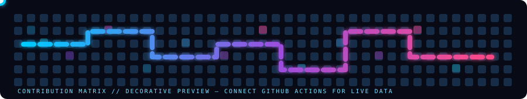

⚡ DILSHAN | DIGITAL COMMAND CENTER

<!-- ANIMATED CYBERPUNK IDENTITY -->

  

<!-- ANIMATED INTRO -->

  

  
  
  

---

**SYSTEM_PROFILE**

<pre>
┌──[DILSHAN@GITHUB]────────────────┐
│                                     │
│  USER       : DILSHAN               │
│  ROLE       : DEVELOPER / BUILDER   │
│  INTERESTS  : TECHNOLOGY & BUSINESS │
│  MINDSET    : EXPERIMENT. IMPROVE.  │
│  STATUS     : CONSTANTLY BUILDING   │
│                                     │
└────────────────────────────────┘
</pre>
  
Hey! I'm Dilshan.

I'm interested in technology, software development, automation, and building things that actually work.

I enjoy experimenting with new ideas, understanding how systems work, fixing problems, and turning concepts into real projects.

I don't just want to use technology. I want to understand how to build it.

**TECH ARSENAL**

  

  
  
  

**ACTIVE OPERATIONS**

[ SYSTEM LOG ]

> Exploring new technologies...
> Building practical projects...
> Experimenting with automation...
> Improving development workflows...
> Learning something new every day...

[ PROCESS RUNNING ]

**GITHUB ANALYTICS**

  
  

  

**CONTRIBUTION MATRIX**

  

**FEATURED PROJECTS**

  
  

**CONNECT WITH ME**

  

  

  <b>⚡ THINK DIFFERENT. BUILD DIFFERENT. ⚡</b>

  © DILSHAN | DIGITAL COMMAND CENTER

